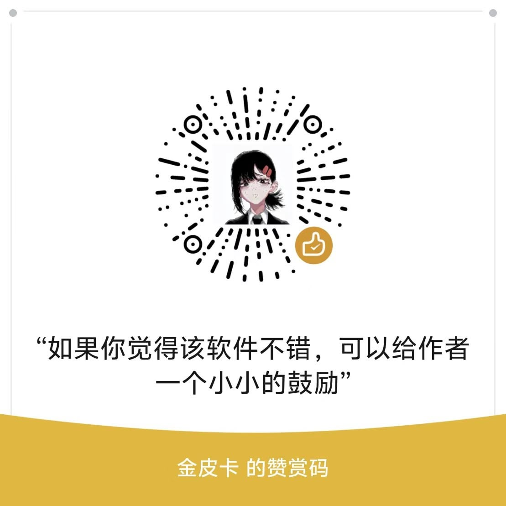

# dsh-team-model（v0.2.0）

开团时给每个队友单独指定模型。语义按约定的来：**不指定就继承 Lead，指定了才走指定路由**，绝不静默跑错模型。

## 现状与边界（先说清楚）

- 本机 DSH 是 asar 打包安装，方式 2 那种直接改 `resources/app/node_modules` 的热补丁**在这台机器上无处下手**，所以本包走增量插件路线：不碰官方 `agent-team / tool-agent-team` 行，不动线上文件。
- 原生链路的卡点：`ctx.subagents.startActivation` 本身支持 `agentOptions`（`{provider, model, reasoningEffort}`），但官方 `roster.spawnAdmitted` 调它时只传了 `prompt + parent`，没往下传（见 `/tmp/dsh-src/packages/experimental/agent-team/src/roster.ts:264`）。所以在官方服务支持透传之前，指定路由**会被服务忽略**。
- **v0.2.0 起不再等上游**：`lib/activation-patch.js` 在宿主里包了一层 `ctx.subagents.startActivation`。roster 是属性查找调用（`this.ctx.subagents.startActivation(...)`），所以实例级包装能接住；包装只对 `spawn` / `fork` 这两个 in-process provider 且 prompt 里带本插件路由标记的调用注入 `agentOptions`，其余调用（原生 spawn、one-shot subagent、out-of-process 后端）原样透传。`manager.ts:390` 的 `resolveChildAgentOptions(parent, request.agentOptions, depth)` 收到即生效。
- 插件仍保留建队后校验：读 `listMembers` 验有效模型，不一致就**明确报错**（不将错就错）。现在校验会通过；若哪天宿主改了 roster 的调用方式导致包装失效，工具会在建队前报 `patch did not install`，而不是白建一个占位成员。

## 文件

- `index.js`：Host 插件，注册 `spawn_teammate_with_model`（Lead-only，用 `tryMembership` 卡）。
- `lib/route.js`：纯函数（解析路由、组装 AgentOptions、校验是否兑现），`checks/` 共用同一份。
- `lib/activation-patch.js`：包装 `ctx.subagents.startActivation` 的补丁层；路由以 HTML 注释
  `<!--dsh-team-model:route:{...}-->` 写进队友 prompt 第一块，包装层解析后注入 `request.agentOptions`。
  带版本号 + 引用计数 + `ensureActivationPatch`（每次建队前自检重装），用于对抗 HMR 双代竞态。
- `checks/parse-route-check.mjs`：离线检查，`node checks/parse-route-check.mjs`。
- `checks/activation-patch-check.mjs`：补丁层离线检查（marker 往返、引用计数、陈旧代替换、原型回退），
  `node checks/activation-patch-check.mjs`。
- `patches/upstream-0001-agent-team-agentoptions.patch`：给官方 `agent-team` 加 `agentOptions` 字段并透传到 `startActivation`。
- `patches/upstream-0002-tool-agent-team-model-param.patch`：给官方 `spawn_teammate` 加可选 `model / reasoning_effort` 参数。
- 两个 patch 都是相对 `/tmp/dsh-src` master 写的，提 upstream PR 前以目标版本 rebase 为准。

## 实测（2026-10-19）

- `model-probe-7` 指定 `company/deepseek-v4.1-flash` → `list_agents` 与返回体均为 `deepseek-v4.1-flash`，
  子代理自己读到的系统提示也标称该模型、provider 为 `company`。
- `model-probe-8` 指定 `qoder/qfmodel` → `model: "qfmodel"`，`routeHonored: true`。
- 不指定时（model-probe / -2 … -6）一律 `deepseek-flash`，即继承 Lead，与原生 `spawn_teammate` 一致。
- 一个坑：HMR 会先 apply 新一代、再 dispose 旧一代，旧 dispose 会把新包装拆掉；且旧代 wrapper 携带旧契约
  无法识别新 marker。已用 `PATCH_VERSION` 强制替换 + `ensureActivationPatch` 每次建队前自检解决。
- 成员上限实测为 8 名队友（Lead 不计入），撞上后报 `Team member limit 8 reached`；v1 无退休语义，名字一旦创建即保留。
- **跨重启语义（2026-10-19 实测）**：重启后 `list_agents` 里未唤醒成员的 `model` 会显示成 Lead 的模型，
  这是 roster 投影回退（`roster.ts:139` 的 `live?.options.model ?? root.options.model`：成员不在活列表时借用
  Lead 的模型），不代表路由丢失。冷恢复时子会话从持久化 descriptor 的 `agentProvider` / `agentModel` 重建
  （`manager.ts:1369-1375`）。直接解压三个子会话的 `session.v4.jsonl.zstd` 读到：
  - model-probe-7（指定 `company/deepseek-v4.1-flash`）→ `agentProvider: company`、`agentModel: deepseek-v4.1-flash`
  - model-probe-8（指定 `qoder/qfmodel`）→ `agentProvider: qoder`、`agentModel: qfmodel`
  - model-probe-2（未指定，对照）→ `agentProvider: deepseek-official`、`agentModel: deepseek-flash`
  descriptor 记的是**解析后的实际路由**（不指定时也写继承值），所以它是“子会话实际用什么”的一手记录，
  不是“请求了什么”的日志。三个成员冷恢复后的系统提示自述与 descriptor 一致（-2 报 deepseek-flash 且无
  provider 字段），排除了“成员一律复述默认值”的反例。
- 重启后新建队验证受上限阻塞（本会话已有 8 名队友），补丁是否重装只能间接确认：工具在调用 roster 前先跑
  `ensureActivationPatch`，本次调用是在通过该检查后才撞上成员上限的；新会话可做完整回归。

## 工具语义

`spawn_teammate_with_model({name, description, prompt, context?, model?, reasoning_effort?})`

- 不传 `model`：与原生 `spawn_teammate` 完全一致，继承 Lead 路由（本会话已用原生路径验证过，recorder 正常 running）。
- 传 `model="<provider>/<model>"`：格式错直接拒（建队前，无副作用）；格式对则带 `agentOptions` 调服务，建队后验 `listMembers[].model`：
  - 一致 → 返回 `{member, routeHonored: true, requestedRoute, effectiveModel}`；
  - 不一致 → 抛错明说「runtime 仍钉在继承路由」，并给出已创建成员名（Teams 名字一旦 provisioning 即保留，v1 无退休语义，中途换模型请用新名字重建）。
- `reasoning_effort` 必须和 `model` 一起给（跟 `subagent` 的成对规则一致）。

## 安装状态（2026-10-18 已装，2026-10-19 已验证生效）

已用 `install_bundle` 装到 desktop profile，`application: applied`，且 `Tool.listTools` 显示 `spawn_teammate_with_model` 已在 live 工具表（HMR 直接生效，无需重启）。首版曾因 `import @deepseek-ai/dsh-tools` 导致 `failed to import`，已改为裸对象 `ctx.tools.register`（本机 local 插件同款写法）后重装通过。

2026-10-19 已完成：带 model 建队真正换路由（company 与 qoder 两条都验过）、不指定时继承、重启后旧成员
冷恢复仍走原路由。剩余验证只剩“重启后新开会话再建一个指定模型队友”这一条（受当前会话成员上限阻塞）。

## 后续（不在 v1）

- 会话标题栏团队面板（每人模型下拉）；
- 退休/休息语义（`retired/resting` 状态机，那是 ExpertKT 另一半的活）；
- 上游合入后：本包零改动，指定路由自动兑现。

---

## ☕ 赞赏支持

如果 dsh-team-model 对你的研究与测试有所帮助，欢迎请作者喝杯咖啡 ☕

  
  

  <b>给项目点个 Star ⭐</b> 同样是对开发者最大的鼓励！

